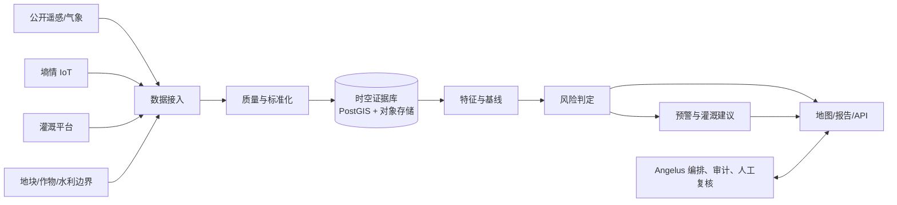

# 大荔农业干旱 GEOINT：模块化架构设计

## 1. 目标与边界

本系统面向大荔县农业干旱的**监测、研判、预警和灌溉辅助决策**。它不是一个替代水利调度系统的“总控台”，也不应把公开卫星底图误当作分析数据。

Angelus 负责工作流编排、人员协作、过程审计与结果解释；GEOINT 负责空间数据、模型计算与地图产品。两者通过明确 API 交互，GEOINT 不依赖 Angelus Session 才能计算。

当前原型的 `GeoIntService` 可保留为 `prototype` 实现：没有真实指标时只输出 `prototype-synthetic`，不得进入预警、报送或灌溉控制链路。



## 2. 模块边界

每个模块有独立的输入契约、输出契约、版本号和运行日志；模块之间只传递已定义的数据对象，不能跨模块直接读写对方的表。

| 模块 | 职责 | 可替换实现 | 不承担的职责 |
|---|---|---|---|
| `catalog` | 数据集、站点、地块、作物季、AOI 与授权目录 | PostGIS + 数据目录 | 下载和算法计算 |
| `ingestion` | 拉取/接收公开数据、IoT CSV/API、灌溉流水 | CHIRPS/ERA5/SMAP/Sentinel、CSV、厂商适配器 | 直接给出风险等级 |
| `quality` | 时区、单位、坐标、缺测、异常、传感器校准与质量标记 | 规则引擎 | 修改原始记录 |
| `feature` | 栅格/站点聚合、同期历史基线、异常值和指数 | 批处理或任务队列 | 风险阈值决策 |
| `risk` | 多信号判定、置信度、等级、原因码、恢复判断 | 规则模型；后期可加入已验证 ML | 灌溉设备控制 |
| `irrigation` | 灌溉约束、需水量、建议和执行反馈 | 作物系数/水量平衡模型 | 自动开阀 |
| `publish` | 矢量瓦片/地图、报表、预警、导出 | FastAPI、任务通知 | 原始数据清洗 |
| `orchestration` | 任务排程、审批、审计、人工复核与回放 | Angelus 工作流 | 修改科学模型本身 |

## 3. 统一数据契约

所有数据进入 `ingestion` 后先保存不可变原始副本，再产生可计算的标准记录。时间统一为 UTC 存储、`Asia/Shanghai` 展示；交换、API、GeoJSON 与空间数据库中的矢量坐标统一使用 WGS84（EPSG:4326）。所有栅格裁切、重采样、面积与距离计算统一使用 WGS 84 / Plate Carrée（EPSG:32662）；离散土地利用分类只能用最近邻重采样。Web 地图瓦片可能以 EPSG:3857 渲染，但它不是分析坐标系。

### 3.1 观测记录 `Observation`

```json
{
  "observation_id": "uuid",
  "dataset_id": "dali-soil-iot-v1",
  "source_type": "iot|remote_sensing|meteorology|irrigation|field_survey",
  "observed_at": "2026-09-03T02:00:00Z",
  "geometry": {"type": "Point", "coordinates": [109.94, 34.80]},
  "entity_ref": "plot:DL-01-023",
  "indicator": "soil_moisture_volumetric",
  "value": 0.173,
  "unit": "m3/m3",
  "depth_cm": {"from": 20, "to": 40},
  "quality_flag": "verified|suspect|missing",
  "provenance": {"provider": "owner", "device_id": "pseudonym", "version": "..."}
}
```

`dataset_id`、采集时间、空间位置、单位、质量标记和来源版本是必填的可追溯字段。农户身份、设备控制凭据、精确井位等不属于风险计算所必需的数据，不进入分析库。

### 3.2 指标格网/地块结果 `FeatureSet`

风险计算输入以“分析单元 + 时段 + 指标”组织，而不是混合不同分辨率的原始像元。初期采用 **5–10 km 网格或灌区/行政单元**；在拥有足够地块、墒情和灌溉数据后，才下沉到地块尺度。

最小指标集：

| 类别 | 指标 | 初始来源 | 作用 |
|---|---|---|---|
| 气象胁迫 | SPI-1、SPI-3 或 SPEI | CHIRPS + ERA5-Land | 识别近期/季节性降水亏缺 |
| 土壤状态 | 根层墒情百分位/异常 | 本地墒情优先，SMAP 作补充 | 确认可利用水是否不足 |
| 植被影响 | NDVI/VCI 同期异常 | Sentinel-2 L2A | 观察作物受胁迫结果 |
| 人为缓解 | 近 7/14 日灌溉量、状态、覆盖率 | 灌溉平台 | 防止“已补灌地块”被误报 |
| 场景约束 | 作物、物候、土壤、地块/灌区 | 农业/水利基础数据 | 让同一阈值不误伤不同作物 |

## 4. 风险判定：可解释的两阶段规则

第一期不直接训练黑盒“风险分”。采用可回溯规则，所有阈值按作物、物候和灌区配置并保留版本。

```text
WATCH    气象异常（SPI/SPEI）触发；等待土壤或作物信号确认
WARNING  气象异常 + 根层墒情低于本地同期 P20
ALERT    WARNING + 植被异常确认，且近期有效灌溉不足
RECOVERY 墒情恢复至 P35 以上，或已灌溉且下一期观测确认改善
```

每次结果须同时输出：`level`、`score`、`confidence`、`reason_codes`、`evidence_refs`、`model_version` 与 `data_freshness`。例如 IoT 断流、云遮挡或只有卫星数据时降低置信度，而不是将缺失默认为干旱。

原型中的固定权重 `.45/.35/.20` 仅作为 UI 演示基线，不能作为生产阈值。生产规则应由当地农技、水利和种植主体用至少 2–3 个完整生长季的回测记录共同校准。

## 5. 灌溉建议与控制边界

`irrigation` 的输出是“建议”，至少包括目标地块/灌区、建议窗口、建议水量区间、理由、约束与置信度。水量需要结合根层缺水量、作物系数、未来降水、可用水源、渠系/井泵能力和近期实灌量计算。

系统第一期只产生工单或消息，必须由有权限的水管员/种植者确认。若后期接入自动控制，控制写接口必须独立为 `irrigation-control` 服务，采用最小权限、双人或明确审批、限额、设备白名单、操作回执和一键停用；它不能复用分析服务的读数据凭据。

## 6. 存储、任务与 API

| 类型 | 推荐存储 | 保留策略 |
|---|---|---|
| 原始 CSV、遥感影像、接口响应 | 对象存储/文件归档，带校验和 | 不可变、按来源授权 |
| 空间实体、观测索引、结果 | PostGIS | 行级来源与版本追溯 |
| 大型栅格/派生指标 | 对象存储 + STAC/元数据目录 | 通过 URI 引用，不塞入 JSONB |
| 任务、失败、审批、审计 | Angelus 状态库/审计表 | 可回放、不可篡改事件流 |

推荐 API 分层：

```text
POST /api/geoint/datasets                 创建数据集与授权元数据
POST /api/geoint/ingestions               提交 CSV/远程拉取任务
GET  /api/geoint/ingestions/{id}          查看质量报告和失败原因
POST /api/geoint/risk-runs                固定输入快照后执行分析
GET  /api/geoint/risk-runs/{id}           返回证据、版本、GeoJSON/瓦片链接
POST /api/geoint/reviews/{id}/approve     人工审核预警或建议
GET  /api/geoint/map/layers               只发布已审核的数据产品
```

现有 `/api/geoint/drought/analyze` 保留为 `prototype` 兼容端点；新生产端点禁止接受由浏览器直接提交的“已算好异常值”作为权威来源，而是引用已入库、已质检的数据集版本。

## 7. 权限和数据治理

角色至少分为：数据所有者、数据管理员、农技研判员、水利研判员、审核人、只读查看者、系统运维。权限按“数据集 + 区域 + 动作”授予。IoT、灌溉流水和地块精确边界默认私有；面向公众的图层进行空间降精度与统计聚合。

每份数据接入应签署用途、范围、更新频率、保存期限、再分发限制、联系人与撤销办法。分析输出必须可追到原始数据版本、清洗规则版本和模型版本；这也是发生误报后能够复盘的前提。

## 8. 交付节奏与验收门槛

### P0：数据可用性试点（4–6 周）

- 选 1 个愿意协作的高标准农田/合作社和 1–3 个灌溉片区。
- 接入边界、作物季、三年历史墒情 CSV、灌溉流水和公开降水/卫星资料。
- 完成数据字典、质量报告、数据所有者确认；不发布自动预警。

### P1：可解释风险产品（6–8 周）

- 实现 `catalog`、`ingestion`、`quality`、`feature`、`risk` 最小链路。
- 每旬生成风险图、证据卡、缺测说明和人工审核队列。
- 用历史旱情、灌溉记录与农技记录回测；验收指标包括命中率、漏报率、误报率、提前量及数据新鲜度。

### P2：灌溉辅助决策（6–10 周）

- 接入灌区约束、实际灌溉反馈和作物物候；输出经审批的建议工单。
- 对比“无建议/有建议”下的缺水缓解、节水量、作物影响，不能仅以风险图美观作为验收。

### P3：扩大与模型迭代

- 扩展至县域、更多作物和更多数据所有者；以版本化回测决定是否引入机器学习。
- 自动控制仅在独立安全评审、稳定回执和责任主体明确后另立项目实施。

## 9. 对当前代码的演进映射

| 现有位置 | 当前事实 | 目标去向 |
|---|---|---|
| `angelus/geoint/service.py` | 原型计算、内存回退、PostGIS 混合在一起 | 拆为 `prototype`、`catalog`、`risk`、`repository` 适配层 |
| `angelus/api/geoint.py` | HTTP 模型与原型接口 | 拆为 datasets、ingestions、risk-runs、reviews 路由 |
| `frontend/static/geoint.js` | 地图交互与演示参数 | 拆为 map、evidence、review、data-quality 前端模块 |
| `angelus/api/__init__.py` | 仅负责装配 | 继续只挂载各 API router，不放领域逻辑 |

下一次编码优先级是先落地 `catalog + ingestion CSV + quality report`，再重写风险服务。这样接入到的第一批墒情/灌溉数据就可被验证和追溯，而不是被直接塞进风险分数。
